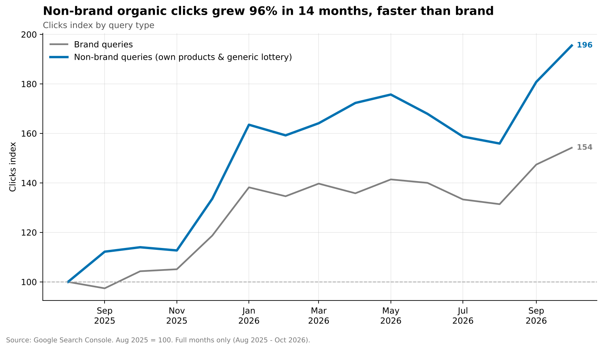

# Organic Search Growth: Online Lottery Platform

**Non-brand organic clicks grew 96% in 14 months, and 56-71% year over year, while impressions stayed flat. The growth came from ranking higher, not from reaching more people.**

I manage SEO and the website channel for an online lottery and instant-games platform. This case study is built from 15 full months of Google Search Console data (Aug 2025 - Oct 2026). The site is moving to a new domain, so I kept the results as data. Everything below is **indexed to Aug 2025 = 100**: no absolute traffic, no query text, no brand names.

## Results at a glance

| | Result |
|---|---|
| Non-brand clicks | +96% (Aug 2025 to Oct 2026), vs +54% for brand clicks |
| Year over year (Aug / Sep / Oct) | non-brand +56% / +61% / +71% |
| Non-brand average position | 8.4 to 3.4 |
| Non-brand share of organic clicks | 27% to 32% |
| Competitor-brand queries ranking in the top 10 | about 3.6x |

## What I worked on

Entity-based SEO and topical authority (semantic cores, topic clusters, pillar pages), internal linking, technical SEO and site health (indexation, redirects, response codes, structured data, duplicate content), UX audits from session recordings and heatmaps, and on-site promotions and game launches as part of channel management.

## 1. Growth beyond brand

Brand traffic comes from marketing and draws. Non-brand growth is where SEO shows.

## 2. Same audience, more clicks

Impressions stayed flat while clicks nearly doubled: pages moved up the results, and CTR rose from about 19% to 36%.

## 3. Year-over-year check

Comparing the same months removes seasonality.

## 4. Mix shift

## 5. Ranking footprint on competitor-brand queries

I also worked on visibility for searches around competitors' brands. The lasting result is the page-one footprint, not the clicks.

In May-June 2026, clicks spiked during a competitor's lottery campaign, then fell back. I treat it as a one-off, not a trend.

## Method

- Every query was classified with ordered regex rules into brand, non-brand, and competitor-brand queries, then aggregated by month.
- Positions are weighted by impressions. Values are indexed to Aug 2025 = 100.
- Tools: Google Search Console (via an MCP connection to Claude), Python, pandas, matplotlib.
- Reproduce the charts: `python build_charts.py` (reads `portfolio_public.csv`).

## Limits

- Search Console keeps 16 months, so the first months of the project (Feb-Jun 2025, when organic traffic started from near zero) are not in the data.
- Rare queries are hidden by Google, so totals sit below the Search Console chart.
- The non-brand group includes own-product queries, so part of its growth may be product demand, not only SEO.
- Competitor-brand classification is rule-based and approximate.
- This shows correlation with my work, not proven causation.
